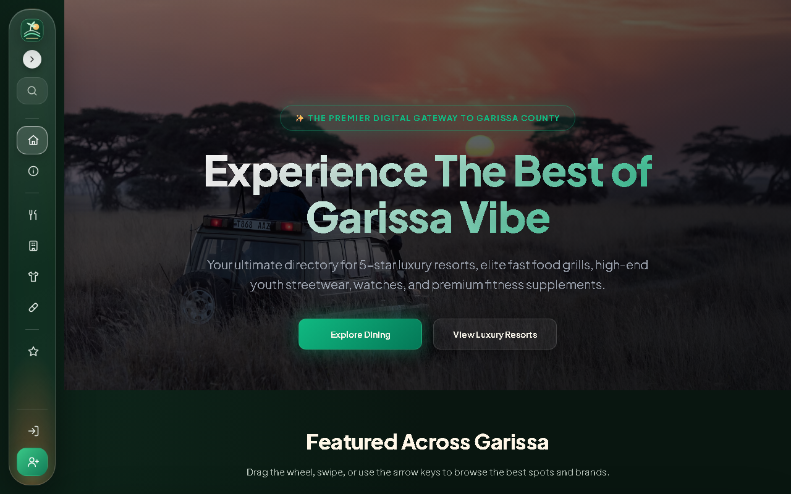
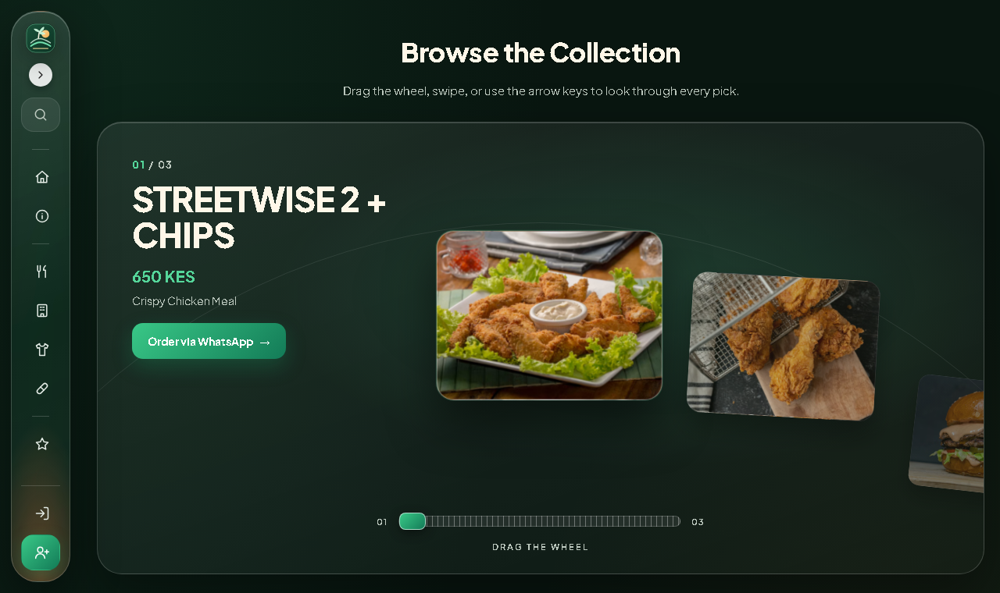
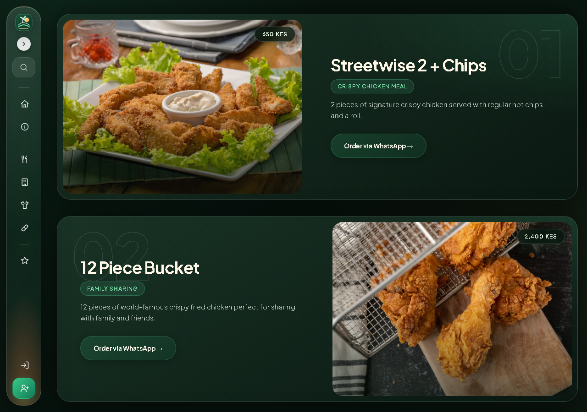
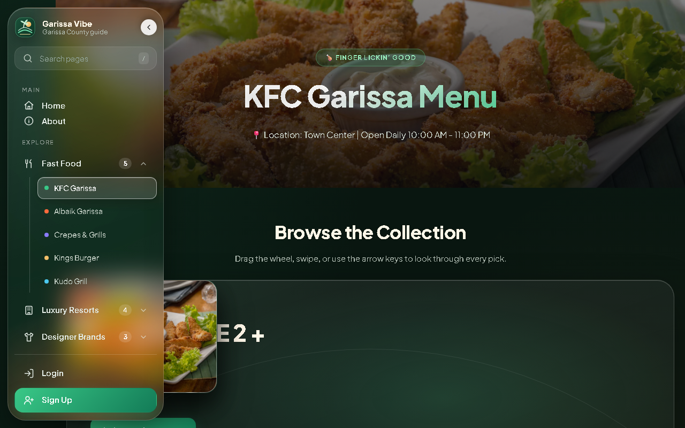
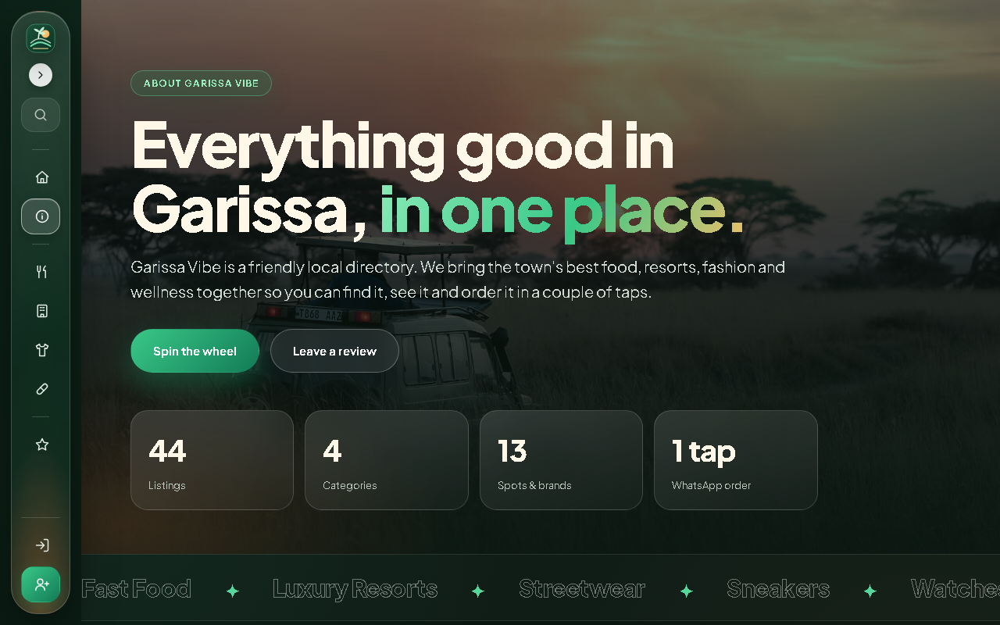
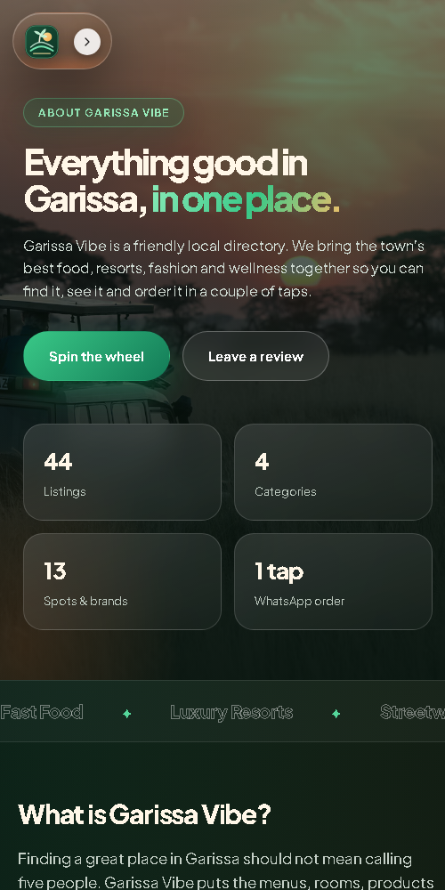

<div align="center">


# Garissa Vibe

**The ultimate digital gateway to Garissa County.**
One place to discover, compare and order from the town's best food spots, luxury resorts, designer brands and wellness shops.

[Live Demo](https://metrixit3-cmd.github.io/Garissa-Vibes/) &nbsp;|&nbsp; [Preview](#preview) &nbsp;|&nbsp; [Features](#features) &nbsp;|&nbsp; [Pages](#pages) &nbsp;|&nbsp; [Getting Started](#getting-started) &nbsp;|&nbsp; [How It Works](#how-it-works)


<a href="https://metrixit3-cmd.github.io/Garissa-Vibes/">
  
</a>

</div>

---

## About

Garissa Vibe is a fast, dependency-free directory website for Garissa County, Kenya. It brings menus, rooms, products and prices from local businesses onto one clean, consistent site, so visitors can browse first and decide later. Most listings connect straight to **WhatsApp**, which means ordering a meal, booking a room or asking about a pair of sneakers is a single tap away.

It is built with plain **HTML, CSS and a small amount of vanilla JavaScript**: no framework, no bundler and no build step. Open it in a browser, or host it anywhere that serves static files.

## Preview

<table>
  <tr>
    <td width="50%"><br><sub><b>Drag-the-wheel showcase.</b> Products ride an arc; drag, use the slider or the arrow keys.</sub></td>
    <td width="50%"><br><sub><b>Scroll-stack cards.</b> Each card sticks and the next slides over it as you scroll.</sub></td>
  </tr>
  <tr>
    <td width="50%"><br><sub><b>Glass sidebar.</b> A collapsible rail that expands into a full navigation panel with search.</sub></td>
    <td width="50%"><br><sub><b>About page.</b> The story of Garissa Vibe with a single wheel holding every listing.</sub></td>
  </tr>
</table>

<div align="center">
  <br>
  <sub><b>Responsive.</b> On phones the sidebar becomes a floating pill and the wheel stacks vertically.</sub>
</div>

## Features

- **Glass sidebar navigation** on every page. It is a compact icon rail that expands into a full panel with grouped sections, live search (press <kbd>/</kbd> to focus) and a remembered open/closed state.
- **Drag-the-wheel showcase.** Each page opens with an arc carousel of its own products. Drag it, use the ribbed slider, the arrow keys, a horizontal trackpad swipe, or click a side item to bring it forward.
- **Everything in one wheel.** The About page gathers all 44 listings into a single wheel, with category chips that jump to Fast Food, Luxury Resorts, Designer Brands or Supplements.
- **Scroll-stack cards.** Product lists use a sticky stacking effect, with a clip-path image reveal and staggered text, so long menus feel like a guided scroll.
- **One-tap WhatsApp ordering.** Every product has a pre-filled message for the seller.
- **Reviews, login and sign-up pages** included as ready-to-wire front-end forms.
- **Responsive and accessible by default.** Layouts adapt from phone to desktop, controls are keyboard reachable with visible focus, and `prefers-reduced-motion` switches off the scroll and wheel animation.
- **Zero dependencies.** One stylesheet, one script, one logo. Fonts load from Google Fonts and photos from Unsplash.

## Pages

| Section | Page | What you will find |
| --- | --- | --- |
| Main | [`index.html`](index.html) | Home, featured wheel and the three category hubs |
| Main | [`about.html`](about.html) | The story, stats, ticker and the all-items wheel |
| Fast Food | [`kfc.html`](kfc.html) · [`albaik.html`](albaik.html) · [`crepes.html`](crepes.html) · [`kingsburger.html`](kingsburger.html) · [`kudo.html`](kudo.html) | Menus and WhatsApp ordering |
| Luxury Resorts | [`palmoasis.html`](palmoasis.html) · [`nomadpalace.html`](nomadpalace.html) · [`lantan.html`](lantan.html) · [`tanagarden.html`](tanagarden.html) | Rooms, pools, dining and gardens |
| Designer Brands | [`fashion.html`](fashion.html) · [`shoes.html`](shoes.html) · [`watches.html`](watches.html) | Streetwear, sneakers and timepieces |
| Wellness | [`supplements.html`](supplements.html) | Protein, vitamins and local honey |
| Community | [`review.html`](review.html) | Leave a review |
| Account | [`login.html`](login.html) · [`signup.html`](signup.html) | Authentication forms (front-end only) |

## Getting Started

No installation is required.

```bash
git clone https://github.com/metrixit3-cmd/Garissa-Vibes.git
cd Garissa-Vibes
```

Then either open `index.html` directly in a browser, or serve the folder locally:

```bash
# any static server works, for example:
python -m http.server 8000
# then visit http://localhost:8000
```

### Project structure

```text
Garissa-Vibes/
├── index.html, about.html, ...   # one HTML file per page
├── style.css                     # all styling: tokens, sidebar, wheel, cards, pages
├── script.js                     # sidebar, product wheel, scroll-stack cards, About page
├── garissa-vibe-mark.svg         # logo
└── assets/                       # README preview images
```

## How It Works

### The product wheel

Each page contains a plain `<ol>` of `wheel-item` elements with their title, price, subtitle and link stored in `data-*` attributes. Without JavaScript this renders as a normal scrolling row. `script.js` then upgrades it into the arc: every item is positioned from its distance to the current index, scaled, rotated and faded along a circle, and the info panel on the left follows the front item.

To add a product to a wheel, add one more `<li class="wheel-item" ...>` and bump the slider's `max`.

### Scroll-stack cards

Cards are `position: sticky` with a staggered `top` offset. A small scroll handler measures how far the next card has travelled over the current one and sets a `--sink` custom property, which drives the scale and brightness of the card underneath. An `IntersectionObserver` adds `.is-in` to trigger the image reveal.

### Styling

Everything lives in `style.css` and is built from a small set of CSS custom properties (colours, radii, easing), so the whole theme can be changed from the `:root` blocks.

## Notes and credits

- Photography is loaded from [Unsplash](https://unsplash.com/). Product pictures are illustrative; swap in your own images in `style.css` for production use.
- Typeface: [Plus Jakarta Sans](https://fonts.google.com/specimen/Plus+Jakarta+Sans).
- The login, sign-up and review forms are front-end only and do not store data yet.
- No licence file has been added, so by default all rights are reserved. Add a `LICENSE` file if you want others to reuse the code.

## Author

Created by [**metrixit3-cmd**](https://github.com/metrixit3-cmd). Powered by maslah, the guy behind the action.

<div align="center">

If you like the project, a star on the repository is appreciated.

</div>
